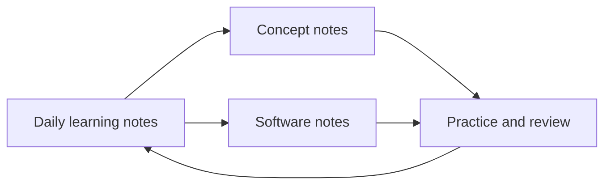

# Requirements

### Goal
Make this repository a minimal Markdown-only starting point for the course’s knowledge-management objective: learners capture, review, retrieve, and apply what they learn about programming.

### Scope
- Follow-up: restore the original educational purpose and three-layer architecture in the README and create the described directory scaffold with an index in each directory. The earlier minimal-layout decisions below record the completed initial implementation; the follow-up supersedes them where they conflict.
- Preserve a reduced version of the existing three-layer organization, with a few examples rather than a prefilled reference library.
- Explain a repeatable learning loop suitable for beginners and intermediate learners, including practice, periodic review, and responsible verification of AI assistance.
- Remove nonessential existing content from the working tree rather than archiving it; existing Git history remains untouched.
- Keep the course’s broader Python curriculum, AI tooling, and programming environment setup outside this repository’s scope.

# Technical Design

### Approach
The existing `workflows/01-daily-learning-and-logging-workflow.md` and `workflows/02-knowledge-distillation-and-promotion-workflow.md` already express capture and promotion; simplify them into one beginner-friendly loop. Preserve the existing layer meanings from `README.md`: software-specific notes, cross-cutting concepts, and active learning. Replace the mandatory seven-file software scaffold and Markdown/notebook parity with a single Markdown note per topic, created as needed.

### Starter layout
- Retain `LICENSE` and rewrite `README.md` as the entry point, with the three layers, copy-and-use instructions, Windows 11-friendly paths, a worked example, and the review/apply loop.
- Keep `active_learning/daily_notes/` for dated study notes and `active_learning/experiments/` for small practice artifacts, with concise indexes; keep `active_learning/README.md` as the layer guide.
- Keep `concepts/` for general knowledge and `software/` for tool-specific knowledge, each with a concise index. Provide one linked, small programming concept example and one minimal Python-specific note, illustrating how a daily observation becomes reusable knowledge and is applied.
- Reduce `templates/` to one daily-note template and one reusable knowledge-note template, adapted from the existing daily and concept templates. Include own-words explanation, retrieval/review, application, source/date, and optional AI assistance with verification.
- Retain one concise workflow in `workflows/`, adapted from the two existing routines; describe capture, practice, review, promotion, retrieval, and updating version-sensitive material.
- Remove other content, including extensive Python reference trees, unused category directories and templates, all `.ipynb` files, `tools/`, and `config.toml` once no retained material depends on them. Rewrite surviving indexes and references to match the final layout.

### Flow

### Boundaries
Git is an optional way to preserve history, not a prerequisite for the basic learning loop. Describe safe, critical AI use without requiring a particular service or collecting token counts; avoid prescribing a specific editor or shell.

# Testing

### Validation
- Walk through the README using the templates: capture a session, apply a small Python example, review it, and promote an insight to the appropriate layer.
- Check that retained Markdown links and referenced paths resolve and that indexes describe only retained files.
- Verify no notebook-parity instructions, notebook files, converter configuration, or platform-specific launcher dependencies remain; check the walkthrough is usable on Windows 11.
- Inspect the final file list and deletion diff to confirm `LICENSE`, the intended examples, and the minimal layer structure remain.

# Delivery Steps

### ✓ Step 1: Build the minimal three-layer starter
The repository contains only the intended learner-facing layer structure and a few representative Markdown examples.

- Reduce `active_learning/`, `concepts/`, and `software/` to the selected daily-note, practice, concept, and Python-note starting points.
- Preserve `LICENSE` and remove nonessential reference content and unused categories.
- Check the retained example paths and layer indexes against the intended structure.

### ✓ Step 2: Implement the learning loop and templates
Learners can capture, review, retrieve, and apply knowledge using a small set of reusable Markdown documents.

- Adapt the existing daily-note and concept templates into daily and general knowledge-note templates.
- Consolidate the existing daily and distillation workflows into one concise process, including practice, review, sources, version awareness, and optional verified AI assistance.
- Link the examples to demonstrate promotion from a daily note to durable knowledge and application.

### ✓ Step 3: Align documentation and remove obsolete tooling
The README describes the reduced Windows-friendly starter without stale references or notebook requirements.

- Rewrite `README.md` and remaining indexes for the final three-layer structure and a concrete learner walkthrough.
- Remove notebook files, converter and launcher tooling, `config.toml`, and unused templates and workflows.
- Verify internal Markdown links, remaining file inventory, and the end-to-end walkthrough; inspect deletions to confirm the intended minimum and `LICENSE` remain.

### ✓ Step 4: Restore the architecture and directory scaffold
Restore the supplied README content while preserving the learning walkthrough, and create indexed directories for the described architecture. Clearly distinguish planned reference content and software scaffolding from material already present, and verify links and directory indexes.